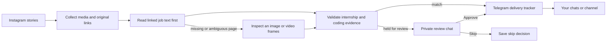
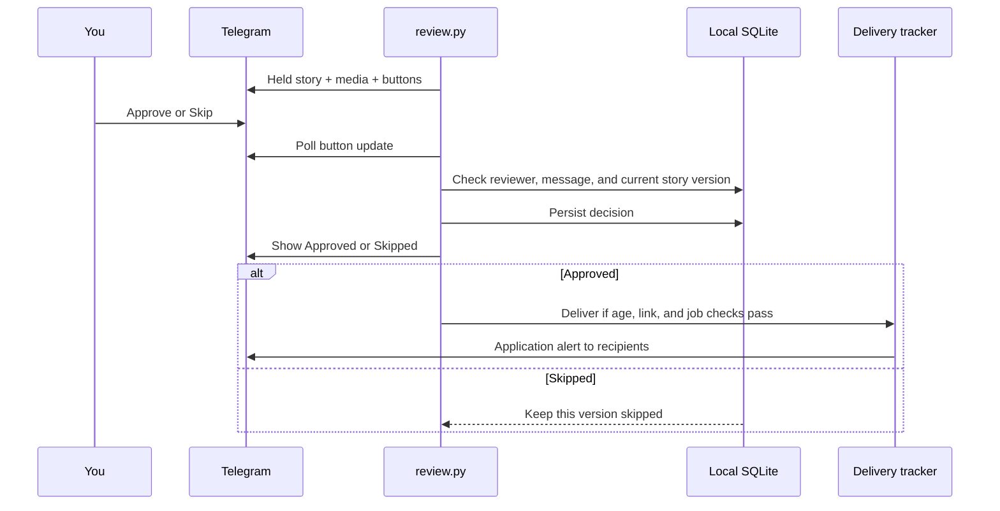

# sudo_scraper

Internship links from Instagram stories, delivered to Telegram.

I built this because I wanted to stay off Instagram without missing the internship
postings zero2sudo shares. Opening the app for one application link was still
opening the app. This collects the stories, finds coding-related internships, and
puts the useful links somewhere I already check.

My setup is a **base M4 Pro Mac mini with 24 GB unified memory and a 512 GB SSD**,
using Qwen3-VL locally through Ollama. The Mac handles collection and inference;
Telegram is the interface on my phone. No separate iOS app is needed.

This is a personal, unofficial project, unaffiliated with Instagram or zero2sudo.
It uses an unofficial Instagram client and cannot guarantee complete coverage,
unrestricted access, or a fixed notification time.

## How it works



- **Collect:** save available images/videos, metadata, and original application links.
  Previously completed downloads are reused.
- **Classify:** try public job-page text before vision. Output is `swe_internship`,
  `uncertain`, or `irrelevant`, with evidence and a reason.
- **Validate:** require an internship/co-op and coding-related work. Unclear cases
  are held, including vision decisions based on sampled video frames.
- **Deliver:** send matches to configured Telegram recipients and track each delivery.
- **Review:** send held stories to one private chat with their saved media and
  Approve / Skip buttons. Decisions survive restarts and repeated pipeline runs.

The `swe_internship` label is intentionally broad: **any coding or development
component counts**, even if it is a small part of the role. AI/ML, data science,
robotics, autonomy, graphics/tools programming, security, scripting, automation,
and hybrid business roles can qualify. The title does not need to say Software
Engineer. Pure non-coding roles, permanent/new-grad jobs, news, advice, and ads do
not qualify. Generic technical internships with unclear duties stay reviewable.

## Requirements

- Python 3.10+ on macOS or Linux. File locks use `fcntl`; Windows is not supported.
- An Instagram account that can normally view the target's stories.
- [Ollama](https://ollama.com/download) for local inference, or a compatible hosted model.
- A Telegram bot and at least one recipient chat.
- An awake, connected machine while the watchers run.

## Setup

```sh
git clone https://github.com/srirsatt/sudo_scraper.git
cd sudo_scraper
python3 -m venv .venv
source .venv/bin/activate
python -m pip install -r requirements.txt
cp .env.example .env
```

For an existing installation, keep `.env` and add missing settings from
[.env.example](.env.example). Never replace a working configuration just to update it.

### 1. Instagram

Set these in `.env` using **your own account**, not the creator's credentials:

```dotenv
INSTAGRAM_USERNAME=your_instagram_username
INSTAGRAM_PASSWORD=
INSTAGRAM_TARGET=zero2sudo
COLLECTOR_DATA_DIR=data
```

Leave the password blank to enter it privately. Authenticate once:

```sh
python collector.py --login
```

Enter any requested verification code. The session and device identity are saved
locally. Later collection reuses them; it does not automatically password-log in.

```sh
python collector.py
```

`Available: 6; newly saved: 1; incomplete: 0` means six stories were available,
one needed downloading, and all downloads are complete.

### 2. Local model

Start Ollama and download the explicit **Instruct** model:

```sh
ollama pull qwen3-vl:8b-instruct
```

```dotenv
LLM_PROVIDER=ollama
LLM_BASE_URL=http://127.0.0.1:11434/v1
LLM_MODEL=qwen3-vl:8b-instruct
LLM_MODE=auto
OLLAMA_THINK=false
LLM_CONTEXT_LENGTH=16384
LLM_TIMEOUT_SECONDS=300
LLM_MAX_OUTPUT_TOKENS=1024
```

Local Ollama needs no API key. Use Qwen3-**VL** for image support. The plain
`qwen3-vl:8b` tag previously emitted reasoning and truncated its JSON output;
use `qwen3-vl:8b-instruct`. If running without the Ollama app, start `ollama serve`.

Try a small batch:

```sh
python classifier.py --mode auto --limit 3
```

The classifier reads saved stories; it does not contact Instagram. Job-page text
may still require public HTTP requests. A large first batch can take minutes;
cached passes generally have less work. Prompt, model, input, or policy changes
invalidate classification caches and can cause a one-time reprocessing backlog.

### 3. Telegram delivery

Create a bot with the official [@BotFather](https://t.me/BotFather), using `/newbot`.
Put the token in `.env`, open your new bot, and press **Start**.

```dotenv
TELEGRAM_BOT_TOKEN=your_bot_token
TELEGRAM_CHAT_IDS=
```

Discover your private chat ID:

```sh
python notifier.py --list-chats
```

If this prints `{}`, send the bot a fresh message and try again. It does not need
to reply. Use the returned numeric ID:

```dotenv
TELEGRAM_CHAT_IDS=123456789
```

For friends, share `https://t.me/YOUR_BOT_USERNAME?start=internships` and keep
`python review.py --watch` running (configure the private reviewer below first).
Opening the link and pressing **Start** sends `/start internships`; the worker
automatically adds that person's private chat ID to `TELEGRAM_CHAT_IDS` in `.env`
and confirms their subscription. `/start` without a link works too. Simply viewing
the link without starting the bot does not subscribe anyone. See Telegram's
[deep-link documentation](https://core.telegram.org/bots/features#deep-linking).

Subscribers can send `/stop` to remove themselves, or `/start` to join again.
New subscribers receive eligible recent postings on upcoming delivery passes,
within the normal age window and per-pass limits. Existing delivery history is
preserved when someone rejoins. A delivery already in progress may still finish
after `/stop`. Signup is open to anyone who starts the bot in a private chat;
subscribers cannot approve or skip your review cards.

The worker atomically updates only the recipient setting, preserving credentials
and reviewer settings. `.env` must be writable. Recipients are read fresh for each
delivery pass without restarting either watcher. For **this setting only**, a
value in `.env` takes precedence over the process environment, including an empty
value after everyone unsubscribes. `--chat-id` still explicitly overrides it.
An empty audience is allowed while waiting for signups. Stop the worker before
manually editing `.env` to avoid overwriting a concurrent signup.

You can also manually add comma-separated IDs for groups/channels; add the bot to
the group or make it a channel administrator with posting rights.
Use a dedicated bot for this project: the review worker owns Telegram update polling
and must not share it with Hermes or another bot gateway/webhook.

Preview and verify one delivery:

```sh
python notifier.py --dry-run
python notifier.py --limit 1
```

Normal delivery includes only eligible stories from the **last 24 hours**. Zero
eligible stories can be correct: matches may be old, held, missing links, or closed.
For deliberate catch-up/testing, pass the same age override to preview and sending:

```sh
python notifier.py --dry-run --max-age-hours 72
python notifier.py --max-age-hours 72 --limit 1
```

### 4. Telegram review

Add your **positive private chat ID** to `.env`:

```dotenv
TELEGRAM_REVIEW_CHAT_ID=123456789
# Optional: defaults to that private chat ID.
TELEGRAM_REVIEW_USER_ID=
```

Only this user in this private chat can approve or skip. Friends and channel members
cannot authorize deliveries by tapping a copied or forwarded button.

Preview held stories, then start the worker:

```sh
python review.py --dry-run --limit 1
python review.py --watch
```

Cards contain the saved image or video, the role, evidence, hold reason, application
buttons when links exist, and **Approve / Skip**. HEIC images are converted for
Telegram. Media over the upload budget or missing from disk falls back to a text
card with a story link. You can review most stories without opening Instagram.



Approval can release an uncertain result or a positive held for video review.
It **does not** override explicit closed/expired status, missing application links,
or the delivery age window. The worker tries approved deliveries itself, so you
do not have to wait for the next pipeline pass. Existing successful deliveries
are skipped per recipient.

A review is bound to the story's classifier inputs, decision, links, and job status.
Unchanged reruns keep it; changed inputs/decisions require a fresh review. The
classifier's JSON remains untouched. Repeated taps do not reverse a saved decision.
A card whose send outcome is ambiguous is not automatically resent; if it actually
arrived, its authenticated button can still resolve it.

The worker handles up to five new review-card attempts per pass. `--limit` changes
that per-pass cap; it is not a lifetime cap in watch mode. Buttons are handled by
outbound long polling, usually within about a polling cycle when the worker is
available. Card uploads, failures, or another busy sender can delay handling.

## Daily use

Run the complete pipeline once:

```sh
python pipeline.py
```

Keep these running in **two terminals** on the Mac mini:

```sh
# Terminal 1: collect, classify, and deliver approximately every ten minutes.
source .venv/bin/activate
caffeinate -i python pipeline.py --watch
```

```sh
# Terminal 2: handle signups, review new held stories, and handle button taps.
source .venv/bin/activate
caffeinate -i python review.py --watch
```

`caffeinate` is macOS-specific. On Linux, run the same Python commands without it.
Keep Ollama running for local inference. Ctrl-C stops either watcher. These are
foreground processes: terminal closure, sleep, or reboot can interrupt them.
Automatic startup after reboot and a native iOS app are not included.

Pipeline stages run sequentially, with independent stage locks and a pipeline lock.
A slow pass delays the next check; passes never overlap within the watcher.
An ordinary failure stops that pass and retries at the next interval. An Instagram
API/account error stops the watcher entirely so you can inspect the account.
There are no automatic password logins or Telegram failure-alert broadcasts.

## Commands

| Task | Command |
| --- | --- |
| Preview the pipeline plan; no requests or writes | `python pipeline.py --dry-run` |
| Inspect the latest executed pass | `python pipeline.py --status` |
| Use saved stories without collecting | `python pipeline.py --skip-collect` |
| Collect/classify without the pipeline's sender | `python pipeline.py --skip-notify` |
| Limit model work and delivery attempts | `python pipeline.py --classification-limit 4 --notify-limit 1` |
| Change watch interval / stage timeout | `python pipeline.py --watch --interval-seconds 600 --stage-timeout 3600` |
| Inspect delivery state | `python notifier.py --status` |
| Inspect review state | `python review.py --status` |
| Poll buttons and queue cards once | `python review.py` |
| Review older held stories deliberately | `python review.py --watch --max-age-hours 72` |
| Classify one saved story again | `python classifier.py --mode auto --force --story-id STORY_ID` |
| Inspect pending classifier inputs without requests | `python classifier.py --mode auto --dry-run` |

Stop the review worker too when testing without live Telegram activity: it runs
independently of the pipeline, so `--skip-notify` does not stop that separate worker.
Both dry-run commands are safe to use without sending messages.

`--notify-limit` counts recipient delivery attempts, not stories. The pipeline's
watch interval has a 60-second minimum; ten minutes is the default, not a coverage
guarantee. Each stage defaults to a one-hour time budget. First batches or small
local machines may need a larger budget.

## Classification and providers

| Mode | Inputs |
| --- | --- |
| `auto` | One linked job description when usable; otherwise fast vision. |
| `fast` | One middle video frame or one image, maximum side 1024 px, no neighbors. |
| `thorough` | Start/middle/near-end video frames and nearby story context. |

Auto extraction supports Greenhouse's public job API, `JobPosting` JSON-LD, and
conservative HTML text. Blocked pages, JS-only shells, mismatched listings, and
ambiguous links fall back to vision. The program does not render job sites in a
browser. Usable job text is cached for one hour; failed fetches for one minute.
`--force` reruns inference but respects page-fetch caching.

The pipeline defaults to auto mode even if an older `.env` says thorough. Standalone
classification uses `LLM_MODE`. Sampled video frames do not cover all frames or
audio; audio is not transcribed. Vision-based video positives require review,
and negatives are held as uncertain. Job-page-based decisions do not require review
solely because the source story is a video. A fetched page is not proof a job is open.

For Fireworks, set:

```dotenv
LLM_PROVIDER=fireworks
FIREWORKS_API_KEY=your_key
FIREWORKS_MODEL=accounts/fireworks/models/YOUR_VISION_MODEL
```

Choose an available model/deployment supporting vision and structured output; an
Ollama tag is not a Fireworks model ID. See the [Fireworks vision guide](https://docs.fireworks.ai/guides/querying-vision-language-models).
The preset uses `https://api.fireworks.ai/inference/v1` and ignores stale local
model/URL settings. An on-demand entry may need an existing deployment; this project
does not provision one.

An OpenAI-compatible preset is available through `LLM_PROVIDER=openai`,
`OPENAI_API_KEY`, and `OPENAI_MODEL`. Custom compatible servers use
`LLM_PROVIDER=custom`, `LLM_BASE_URL`, `LLM_MODEL`, and optional `LLM_API_KEY`.
Claude's native API is not implemented. There is no automatic paid-provider fallback.
Hosted inference sends the job text or selected story images and metadata to that
provider and can incur charges. Instagram credentials are not sent to it.

## Persistence and recovery

```text
data/
  session.json                           Instagram session; keep private
  state.json                             Collection state
  stories/<target>/<story-id>/            Original story.json and media
  classifications/<target>/<id>.json      Model output, final label, and evidence
  job_pages/                             Cached public job text
  telegram/
    deliveries.sqlite3                   Per-recipient delivery attempts
    reviews.sqlite3                      Review cards, decisions, and polling offset
  pipeline/
    last_run.json                        Last pass and stage timings
    events.jsonl                         Stage history
```

Back up this directory privately when moving to the Mac mini. Keep the delivery
and review databases across restarts. Deleting them can allow repeats. A custom
data directory must also be excluded from Git. `.env` and the default `data/` are
already ignored. New files created by the CLIs use restrictive permissions.

Successful sends store Telegram message IDs. Deduplication is per bot, recipient,
and story; it does not merge the same job reposted in different stories.
Telegram does not provide an idempotency key for `sendMessage`, so exact-once
network delivery cannot be promised.

| Delivery state | Meaning |
| --- | --- |
| `sent` | Telegram confirmed receipt; skip on later runs. |
| `retry` | Wait for the persisted cooldown, then retry if still eligible. |
| `rejected` | Fix credentials/permissions and explicitly resolve. |
| `unknown` | The message may have arrived; inspect the chat before retrying. |
| `sending` | The process stopped before saving an outcome; inspect the chat. |

For an ambiguous application alert, mark it delivered after inspecting the chat:

```sh
python notifier.py --resolve-story STORY_ID --chat-id CHAT_ID --resolution sent
```

Or explicitly permit a retry if it did not arrive:

```sh
python notifier.py --resolve-story STORY_ID --chat-id CHAT_ID --resolution retry
python notifier.py
```

For an ambiguous/rejected **review card**, inspect the review chat first, then:

```sh
python review.py --status
python review.py --retry-card CARD_ID
```

Stop the review watcher before using `--retry-card`; only one polling worker can run.
Review decisions are `approved` or `skipped`, separate from card delivery state.
Telegram 429 responses persist send cooldowns. Control polling respects Telegram's
retry delay; authentication, permission, and polling conflicts stop the review worker.
Neither component removes an existing webhook automatically.

## Troubleshooting

- **No chat IDs:** message the exact bot whose token is in `.env`; stop other polling
  workers before discovery. Another gateway or webhook can conflict.
- **Zero eligible stories:** check age, links, job status, and review flags. Use an
  explicit age override for old test data rather than disabling eligibility checks.
- **Buttons do nothing:** keep `review.py --watch` running, use the configured private
  account/chat, and inspect worker logs. A stale card requires a fresh review.
- **Instagram rejects access:** inspect the account in the official app. Do not loop
  password logins. For `needs_upgrade`, update dependencies and explicitly log in
  again, preserving the saved session/device profile.
- **Ollama unavailable or truncated JSON:** keep the server running, check `ollama list`,
  and use the explicit Instruct tag with `OLLAMA_THINK=false`. Local request timeout
  defaults to 300 seconds. More input/context can increase memory use and latency.
- **Slow collection:** the collector uses normal one-second library pacing; network
  and media sizes still matter. `request_timeout` in instagrapi is a pacing sleep,
  while media HTTP requests use `read_timeout`.
- **A pass failed:** inspect `python pipeline.py --status` and terminal output.
  The event log records stages and exit codes; detailed child output stays in the
  terminal. Local preflight errors happen before a pass and do not replace its status.

## Development

```sh
python -m unittest discover -s tests -v
```

Tests use temporary files and fake network/model responses. They cover collection,
media decoding, job-page extraction, provider contracts, eligibility, pipeline
failures, delivery tracking, and review authorization. They do not measure general
model accuracy or prove live Telegram/Instagram availability. Review cards and
callbacks should be smoke-tested with your own bot after configuration.

Source map: [collector.py](collector.py), [job_page.py](job_page.py),
[classifier.py](classifier.py), [llama.py](llama.py), [media.py](media.py),
[notifier.py](notifier.py), [review.py](review.py), [pipeline.py](pipeline.py).

Writing drafts: [minimal blog post](docs/blog.md) · [X post](docs/x-post.md).
